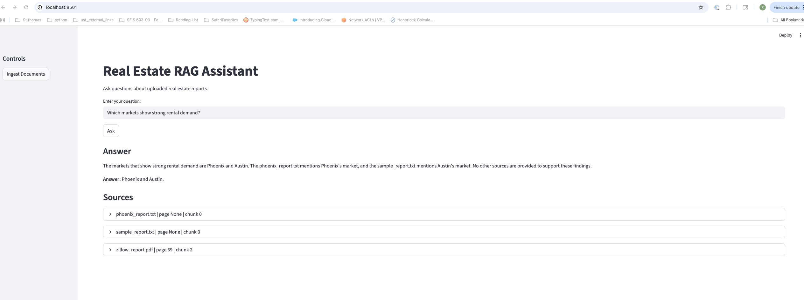

# Real Estate RAG Assistant

A domain-specific Retrieval-Augmented Generation (RAG) system for real estate market intelligence. This project ingests housing reports and market documents, stores chunk embeddings in PostgreSQL with pgvector, retrieves relevant evidence for user questions, and generates source-grounded answers using an LLM.

## Features

- PDF and TXT document ingestion
- Text chunking with metadata
- Embedding generation with sentence-transformers
- Vector storage with PostgreSQL + pgvector
- Semantic retrieval
- Document-diverse retrieval
- Hybrid retrieval with keyword boosting
- LLM-based answer generation with citations
- FastAPI backend
- Streamlit frontend
- Retrieval evaluation notebook

## Architecture

### Offline indexing pipeline
Documents / PDFs → Data Ingestion and Cleaning → Chunking and Metadata → Embeddings → PostgreSQL + pgvector

### Online query pipeline
User Question → Query Embedding → Retriever → Top Relevant Chunks → LLM with Context → Answer with Citations

## Tech Stack

- Python
- FastAPI
- Streamlit
- PostgreSQL
- pgvector
- SQLAlchemy
- sentence-transformers
- Ollama
- Jupyter Notebook

## Project Structure

```text
real-estate-rag/
├── app/
├── data/
├── images/
├── notebooks/
├── scripts/
├── ui/
├── .gitignore
├── README.md
├── requirements.txt
└── docker-compose.yml
```

## Setup

### 1. Clone the repository
git clone <your-repo-url>
cd real-estate-rag

### 2. Create and activate a virtual environment
python3 -m venv venv
source venv/bin/activate

### 3. Install dependencies
pip install -r requirements.txt

### 4. Start PostgreSQL with pgvector
docker compose up -d

### 5. Start the API
PYTHONPATH=. uvicorn app.api:app --reload

### 6. Start the Streamlit UI
PYTHONPATH=. python -m streamlit run ui/streamlit_app.py

## Data Sources

This project is designed to work with publicly available real estate market reports and housing research documents.

To respect copyright and redistribution restrictions, source documents are not included in this repository. Users should download reports directly from the original publishers and place them in `data/raw/` before ingestion.

## Example Questions

- Which markets show strong rental demand?
- Which market mentions insurance costs?
- Which market mentions in-migration?
- What affordability risks are mentioned?

## Retrieval Evaluation

A small benchmark was created to test whether the retriever returned the expected source documents.

### Hit@3 Results
- Balanced small corpus: 100%
- With large Zillow PDF, baseline vector retrieval: 25%
- With document-diverse retrieval: 50%
- With hybrid retrieval: 75%

### Key Finding
Large multi-page documents can dominate retrieval in small corpora. Adding document-diverse retrieval and hybrid retrieval improved ranking quality substantially.

## Future Improvements

- Upload and ingest documents directly from the UI
- Better PDF page-level citations
- Reranking
- Smarter chunking
- Full Dockerization of API + UI
- Expanded evaluation dataset

## Resume Summary

Built a domain-specific RAG system for real estate market intelligence using Python, FastAPI, PostgreSQL/pgvector, sentence-transformers, and Ollama, with evaluation-driven improvements including document-diverse and hybrid retrieval.

## Screenshots

### Streamlit UI


### FastAPI Docs


### Evaluation Results

